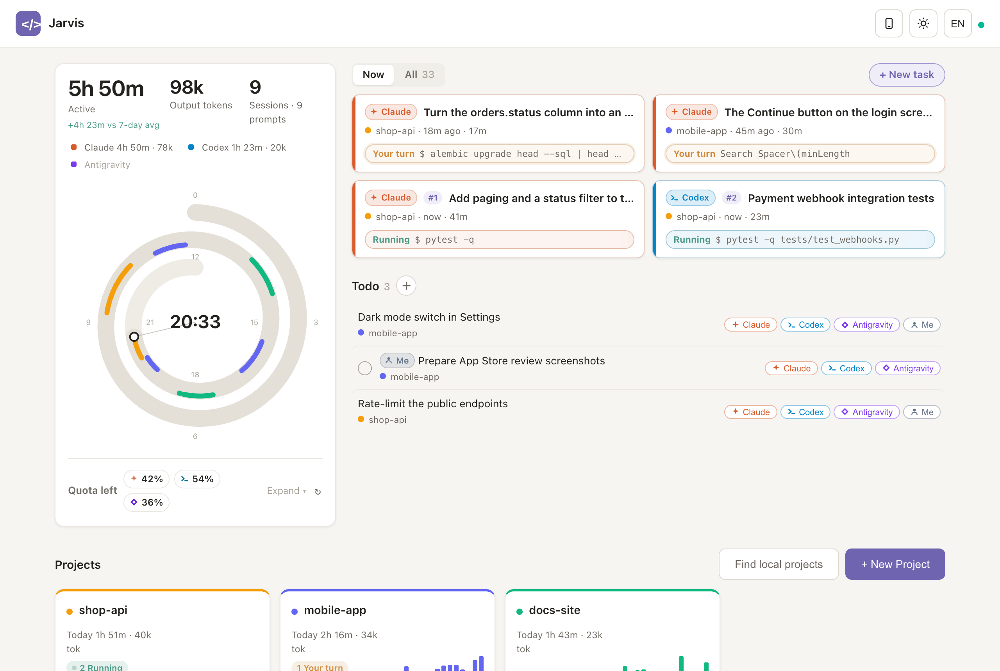
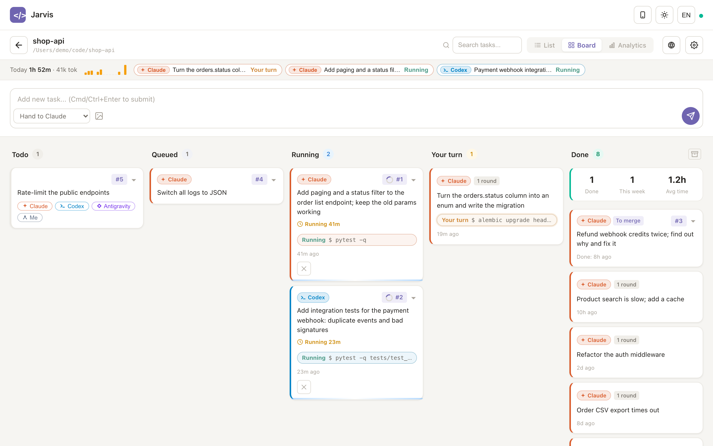
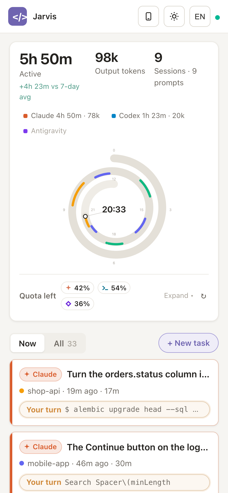
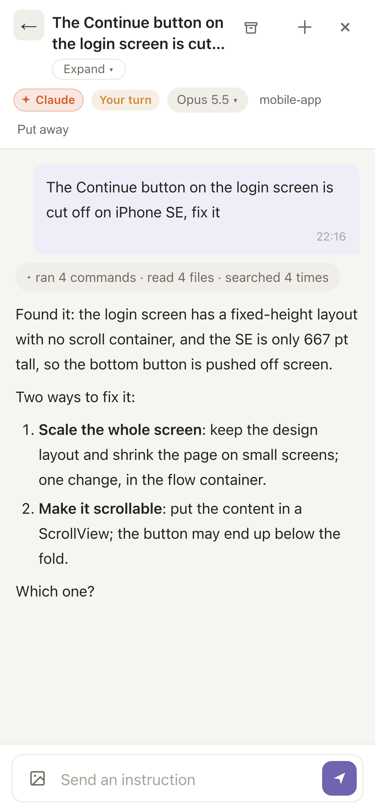
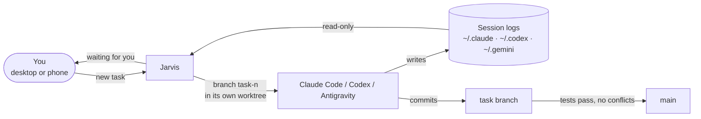
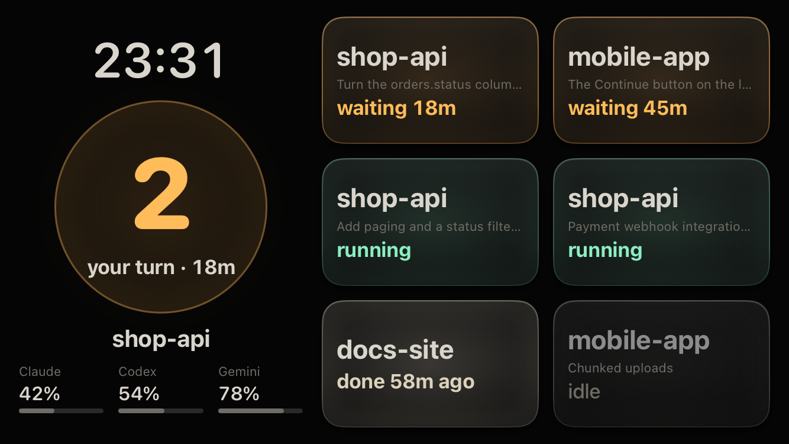

# Jarvis

[中文](README.zh-CN.md)

**Every coding agent on your machine in one place — and the one waiting for you, answered from your desk or your phone.**

A self-hosted dashboard for Claude Code, OpenAI Codex and Google Antigravity: see at a
glance which session is running, which one is waiting for you and which has finished,
reply from your phone, and run tasks in parallel, each in its own git worktree.



With Claude Code, Codex and Antigravity sessions running side by side, the hard part
is no longer the code; it is noticing which session has stopped to ask you something.
Jarvis reads the session logs these tools already keep, sorts them by who has to act
next, and hands out new tasks that each run on their own git branch.

One Python process (FastAPI) and a plain HTML/JS page: no database, no build step.
The interface starts in Chinese; switch to English with the 中/EN button in the header.

## What it does

- **Every session in one view.** Claude Code, Codex and Antigravity, grouped by
  project: running, waiting for you, just finished, close to the context limit.
  Read-only: it never edits their logs.
- **Answer from anywhere.** Open a session, read it, reply, interrupt it or queue
  the next instruction, on the phone too.
- **Tasks in parallel.** Each task runs headless in its own git worktree and branch;
  merge it from the page once the tests pass.
- **A board by who acts next.** Todo / Queued / Running / Waiting for you / Done.
- **Quota at a glance.** What is left of your Claude, Codex and Antigravity limits.
- **A lamp on your desk.** An old iPhone becomes a status light for your agents; tap
  a key and that session comes up on your Mac ([Desk display](#desk-display-optional)).



<p>
  
  
  
</p>

<sub>Screenshots use made-up demo projects.</sub>

## How Jarvis compares

Most tools for running many coding agents are launchers: the agents run inside them.
Jarvis is the other way round. It watches the sessions you already have, wherever
you started them (a terminal, the Claude desktop app, Codex, Antigravity), and
tells you which one needs you, at the computer or away from it.

| | Jarvis | [Linear](https://linear.app/coding-sessions) | [Conductor](https://conductor.build) | [Herdr](https://github.com/ogulcancelik/herdr) | [Claude Squad](https://github.com/smtg-ai/claude-squad) | [Agent Deck](https://github.com/asheshgoplani/agent-deck) |
|---|---|---|---|---|---|---|
| What it is | Local web dashboard + desk lamp | Issue tracker; agents in Linear's cloud | Mac app | Terminal multiplexer for agents | Terminal app (tmux) | Terminal app (tmux) + web UI |
| Agents run on | Your machine | Linear's cloud | Your Mac | Your machine (or over ssh) | Your machine | Your machine |
| Sessions you started elsewhere | Shown, from their logs | — | Its own | Its own | Its own | — |
| Sorted by who acts next | Yes | — | Status per task | Working / blocked / done | Status per task | Status per session |
| Phone | Read, reply, interrupt | Linear's mobile app | — | — | — | Web UI |
| Status light, tap to open on the Mac | Yes | — | — | — | — | — |
| Parallel tasks on branches | Worktree per task; merge after tests and a conflict check | Draft pull requests | Workspace per task; diff review, PR, merge | — | Worktree per task; commit and push | Worktrees |
| License | MIT | Paid service | Closed source | Apache-2.0 | AGPL-3.0 | MIT |

Pick Jarvis if you run several agents at once and want to know, from anywhere, which
one is waiting for you. Pick a launcher if you want the agents themselves inside one
app or one terminal; the two combine well. Details of other tools are from their own
pages as of November 2026.

## How it works



Sessions you start yourself (terminal, desktop app) show up the same way: Jarvis
only reads their logs, and replies you send from the page resume them.

## Requirements

- Python 3.11+
- `git`
- At least one agent CLI on your `PATH`, signed in:
  - `claude` (Claude Code) — used for most features
  - `codex` (OpenAI Codex CLI) — optional
  - `agy` (Google Antigravity) — optional
- macOS is the primary platform. Linux should mostly work, but is untested; the
  Claude desktop-app session list is macOS only.

## Quick start

```bash
git clone https://github.com/alizeeblack-code/jarvis.git
cd jarvis
pip3 install -r requirements.txt
./start.sh            # http://localhost:5100
```

`./start.sh 8080` picks another port; `./start.sh --dev` reloads when files in
`static/` change.

Then click **+ 新建项目** (New project) and choose a git repository. Adding a project
appends a task section to the repository's `CLAUDE.md` and creates a `PROGRESS.md`
there, so the agents know how to report back. The section is written in the
interface language at the time (switch with 中/EN in the header first).

### Let agents use the task tools (optional)

```bash
claude mcp add --transport stdio -s user task-manager -- python3 /path/to/jarvis/mcp_task_server.py
```

The MCP server finds the running dashboard on its own (it records its port in
`data/server_port`); set `JARVIS_URL` to override.

## Desk display (optional)



`/desk` is a status screen for an old phone left on your desk: one big lamp saying
how things stand and, beside it, six frosted keys, one per session, lit in muted
colours by state (blue running, amber waiting on you, green done, grey idle, red
error; the iOS app uses mint for running and warm white for done). Only what needs
you moves, slowly. When a session turns to you, finishes or fails, the screen washes
once in that colour and chimes; a turn still waiting chimes again every 5 minutes
until you tap. Tap a key (or the big lamp, for the session it shows) to bring that
session up on the Mac: a Claude desktop-app session opens itself, one in a terminal
or editor brings that app to the front. The screen is woken first; if the Mac is
locked, Jarvis waits for you to unlock it (Touch ID, Apple Watch) and opens the
session then, or unlocks it for you if you opted in (see
[Security](#security)). Open the page from another device as described there.

In a phone browser you tap once to allow sound, and the screen sleeps unless you
turn auto-lock off. `ios/JarvisDesk` is a native iOS app (SwiftUI, iOS 15+) that
draws the same screen from `GET /api/desk`, keeps the screen on, chimes even with
the silent switch on, shows the time above the lamp and what is left of the Claude,
Codex and Gemini quotas below it, and lowers the screen brightness after 10 quiet
minutes (more at night):

```bash
cd ios/JarvisDesk
./configure.sh <your Apple team ID>   # writes Config/Local.xcconfig with this machine's address and token
open JarvisDesk.xcodeproj             # run it on the phone
```

Press and hold with two fingers to change the address. To install on an iOS 15
device you need Xcode 26.0.1–26.6; Xcode 27 debugs iOS 17 and later only.

## Security

Read this before exposing Jarvis beyond your own machine.

- **Agents run with broad permissions.** Tasks run unattended, so nothing can stop
  to ask you for approval:
  - **Claude** always auto-approves every tool call, whatever the project setting.
  - **Codex** and **Antigravity** run in their sandbox (write access to the
    workspace only, network allowed) unless the project's "skip permissions"
    setting is on.

  Only add repositories you trust, and treat access to Jarvis as shell access to
  your user account.
- **By default Jarvis listens on `127.0.0.1` only.** Requests from this machine
  need no token.
- **To use it from your phone or another computer,** start it with
  `JARVIS_HOST=0.0.0.0 ./start.sh` (ideally reachable only over a VPN such as
  Tailscale). Every other device then needs the access token:
  - it is created on first run in `data/access_token` (or set `JARVIS_TOKEN`);
  - on this machine, the phone icon in the header lists ready-made links that
    carry the token; open one once on the other device and a cookie keeps you
    signed in;
  - API clients can send `Authorization: Bearer <token>`.
- **Cross-site browser requests are rejected,** so a web page you visit cannot
  drive Jarvis on `localhost`.
- **Behind a reverse proxy on the same machine,** set `JARVIS_LOCAL_NO_TOKEN=0`;
  otherwise every proxied request looks local.
- There is no TLS. Use a VPN or put Jarvis behind an HTTPS proxy.
- **Unlocking the Mac from the desk display is off unless you turn it on.** To turn
  it on, store your login password in your login keychain yourself and give the
  Python that runs Jarvis Accessibility access (System Settings → Privacy & Security
  → Accessibility):

  ```bash
  security add-generic-password -U -s jarvis-unlock -a "$USER" -w
  ```

  A tap on a locked Mac then types the password into the lock screen. It tries at
  most once a minute and stops for an hour after a wrong password, so the account
  is never locked out. `scripts/unlock-probe.sh` checks that typing works on your
  Mac first. **Anyone holding the access token can then unlock this Mac;** delete
  the keychain item to turn it off.

## Configuration

| Variable | Default | Purpose |
|---|---|---|
| `JARVIS_HOST` | `127.0.0.1` | Address `start.sh` listens on |
| `JARVIS_TOKEN` | contents of `data/access_token` | Access token for other devices |
| `JARVIS_LOCAL_NO_TOKEN` | `1` | Set to `0` behind a local reverse proxy |
| `JARVIS_URL` | `http://localhost:<recorded port>` | Where `mcp_task_server.py` sends progress |

Per-project settings (test command, worktree setup command, max parallel tasks,
dev port, auto-commit, skip permissions) are in the project's settings dialog.

### Antigravity models

The models offered for Antigravity tasks are built in (`usage.py`). To change
them, create `data/models.json`; any key you leave out keeps its built-in value:

```json
{
  "antigravity": {
    "default": {"model": "gemini-4-hydrogen-high", "label": "Hydrogen"},
    "fallback": "claude-sonnet-5-5-high",
    "choices": {
      "argon": {"model": "gemini-4-argon-high", "label": "Argon"}
    },
    "keep_high": ["claude-opus-5-5"]
  }
}
```

- `default`: used when a task doesn't pick a model.
- `fallback`: tried next when the chosen model's quota runs out.
- `choices`: the other options in the task box.
- `keep_high`: model families never run below their `-high` variant. Families of
  the models listed above count already.

Restart Jarvis after editing the file. Claude and Codex use whatever model their
own CLI is set to.

## Project layout

| Path | What it is |
|---|---|
| `server.py` | FastAPI app: REST API, WebSocket, worker manager |
| `access.py` | Access control (token, cross-site checks) |
| `worker.py`, `agents.py` | Run Claude / Codex / Antigravity tasks |
| `gitflow.py` | Worktrees, branches, merging |
| `sessions.py`, `overview.py`, `board.py` | Session index, overview, board |
| `transcript.py`, `session_send.py` | Read a session; continue it from the browser |
| `store.py` | Projects and tasks (`data/projects.json`) |
| `usage.py` | Quota tracking |
| `desk.py`, `static/desk.*` | Desk display (`/desk`) |
| `reveal.py` | Opens a session on the Mac when its desk key is tapped (and the opt-in unlock) |
| `scripts/unlock-probe.sh` | Checks that the opt-in unlock can type on this Mac |
| `ios/JarvisDesk/` | Native iOS app for the desk display |
| `mcp_task_server.py` | MCP task tools for agents on this machine |
| `mcp_task_client.py` | The same tools for an agent on another machine, over HTTP (`--host`, `--port`, `--token`) |
| `static/` | Front end |
| `data/`, `logs/` | Runtime state (git-ignored) |

## Tests

```bash
python3 -m pytest tests -q
```

## Acknowledgements

- [Agent Deck](https://github.com/asheshgoplani/agent-deck): the overview of every
  agent session and the progress pills on its cards borrow from it.
- Nautilus Spiral: the spiral day clock on the overview.
- 提高 Agentic Coding 吞吐量的 10 个阶段 ("10 stages to higher agentic coding
  throughput"): the idea of many agents working in parallel, one task each, that
  this project started from.

## License

[MIT](LICENSE)
