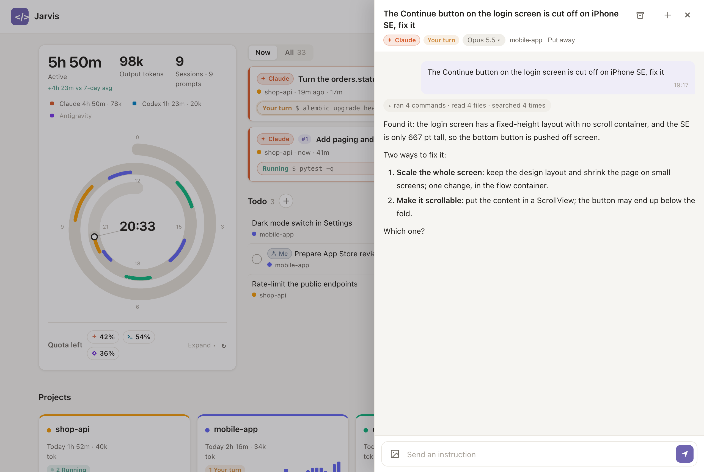

# Jarvis

[中文](README.zh-CN.md)

**Every coding agent on your machine in one place — and the one waiting for you, answered from your desk or your phone.**


With Claude Code, Codex and Antigravity sessions running side by side, the hard part
is no longer the code; it is noticing which session has stopped to ask you something.
Jarvis reads the session logs these tools already keep, sorts them by who has to act
next, and hands out new tasks that each run on their own git branch.

One Python process (FastAPI) and a plain HTML/JS page: no database, no build step.
The interface starts in Chinese; switch to English with the 中/EN button in the header
(the main screens are fully translated, a few dialogs are not yet).

## What it does

- **Every session in one view.** Claude Code, Codex and Antigravity, grouped by
  project: running, waiting for you, just finished, close to the context limit.
  Read-only: it never edits their logs.
- **Answer from anywhere.** Open a session, read it, reply, interrupt it or queue
  the next instruction, on the phone too.
- **Tasks in parallel.** Each task runs headless in its own git worktree and branch;
  merge it from the page once the tests pass.
- **A board by who acts next.** Todo / Queued / Running / Waiting for you / Done.
- **Quota at a glance.** What is left of your Claude, Codex and Antigravity limits.


<p>
  
  
</p>

<sub>Screenshots use made-up demo projects.</sub>

## How it works


Sessions you start yourself (terminal, desktop app) show up the same way: Jarvis
only reads their logs, and replies you send from the page resume them.

## Requirements

- Python 3.11+
- `git`
- At least one agent CLI on your `PATH`, signed in:
  - `claude` (Claude Code) — used for most features
  - `codex` (OpenAI Codex CLI) — optional
  - `agy` (Google Antigravity) — optional
- macOS is the primary platform. Linux should mostly work, but is untested; the
  Claude desktop-app session list is macOS only.

## Quick start

```bash
git clone https://github.com/alizeeblack-code/jarvis.git
cd jarvis
pip3 install -r requirements.txt
./start.sh            # http://localhost:5100
```

`./start.sh 8080` picks another port; `./start.sh --dev` reloads when files in
`static/` change.

Then click **+ 新建项目** (New project) and choose a git repository. Adding a project
appends a task section to the repository's `CLAUDE.md` and creates a `PROGRESS.md`
there, so the agents know how to report back. The section is written in the
interface language at the time (switch with 中/EN in the header first).

### Let agents use the task tools (optional)

```bash
claude mcp add --transport stdio -s user task-manager -- python3 /path/to/jarvis/mcp_task_server.py
```

The MCP server finds the running dashboard on its own (it records its port in
`data/server_port`); set `JARVIS_URL` to override.

## Security

Read this before exposing Jarvis beyond your own machine.

- **Agents run with broad permissions.** Tasks run unattended, so nothing can stop
  to ask you for approval:
  - **Claude** always auto-approves every tool call, whatever the project setting.
  - **Codex** and **Antigravity** run in their sandbox (write access to the
    workspace only, network allowed) unless the project's "skip permissions"
    setting is on.

  Only add repositories you trust, and treat access to Jarvis as shell access to
  your user account.
- **By default Jarvis listens on `127.0.0.1` only.** Requests from this machine
  need no token.
- **To use it from your phone or another computer,** start it with
  `JARVIS_HOST=0.0.0.0 ./start.sh` (ideally reachable only over a VPN such as
  Tailscale). Every other device then needs the access token:
  - it is created on first run in `data/access_token` (or set `JARVIS_TOKEN`);
  - on this machine, the phone icon in the header lists ready-made links that
    carry the token; open one once on the other device and a cookie keeps you
    signed in;
  - API clients can send `Authorization: Bearer <token>`.
- **Cross-site browser requests are rejected,** so a web page you visit cannot
  drive Jarvis on `localhost`.
- **Behind a reverse proxy on the same machine,** set `JARVIS_LOCAL_NO_TOKEN=0`;
  otherwise every proxied request looks local.
- There is no TLS. Use a VPN or put Jarvis behind an HTTPS proxy.

## Configuration

| Variable | Default | Purpose |
|---|---|---|
| `JARVIS_HOST` | `127.0.0.1` | Address `start.sh` listens on |
| `JARVIS_TOKEN` | contents of `data/access_token` | Access token for other devices |
| `JARVIS_LOCAL_NO_TOKEN` | `1` | Set to `0` behind a local reverse proxy |
| `JARVIS_URL` | `http://localhost:<recorded port>` | Where `mcp_task_server.py` sends progress |

Per-project settings (test command, worktree setup command, max parallel tasks,
dev port, auto-commit, skip permissions) are in the project's settings dialog.

### Antigravity models

The models offered for Antigravity tasks are built in (`usage.py`). To change
them, create `data/models.json`; any key you leave out keeps its built-in value:

```json
{
  "antigravity": {
    "default": {"model": "gemini-4-hydrogen-high", "label": "Hydrogen"},
    "fallback": "claude-sonnet-5-5-high",
    "choices": {
      "argon": {"model": "gemini-4-argon-high", "label": "Argon"}
    },
    "keep_high": ["claude-opus-5-5"]
  }
}
```

- `default`: used when a task doesn't pick a model.
- `fallback`: tried next when the chosen model's quota runs out.
- `choices`: the other options in the task box.
- `keep_high`: model families never run below their `-high` variant. Families of
  the models listed above count already.

Restart Jarvis after editing the file. Claude and Codex use whatever model their
own CLI is set to.

## Project layout

| Path | What it is |
|---|---|
| `server.py` | FastAPI app: REST API, WebSocket, worker manager |
| `access.py` | Access control (token, cross-site checks) |
| `worker.py`, `agents.py` | Run Claude / Codex / Antigravity tasks |
| `gitflow.py` | Worktrees, branches, merging |
| `sessions.py`, `overview.py`, `board.py` | Session index, overview, board |
| `transcript.py`, `session_send.py` | Read a session; continue it from the browser |
| `store.py` | Projects and tasks (`data/projects.json`) |
| `usage.py` | Quota tracking |
| `mcp_task_server.py` | MCP task tools for agents on this machine |
| `mcp_task_client.py` | The same tools for an agent on another machine, over HTTP (`--host`, `--port`, `--token`) |
| `static/` | Front end |
| `data/`, `logs/` | Runtime state (git-ignored) |

## Tests

```bash
python3 -m pytest tests -q
```

## Acknowledgements

- [Agent Deck](https://github.com/asheshgoplani/agent-deck): the overview of every
  agent session and the progress pills on its cards borrow from it.
- Nautilus Spiral: the spiral day clock on the overview.
- 提高 Agentic Coding 吞吐量的 10 个阶段 ("10 stages to higher agentic coding
  throughput"): the idea of many agents working in parallel, one task each, that
  this project started from.

## License

[MIT](LICENSE)
