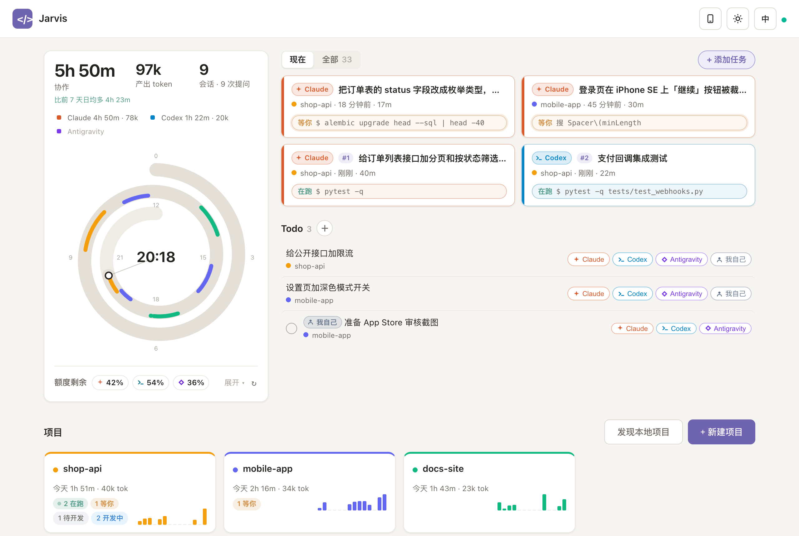
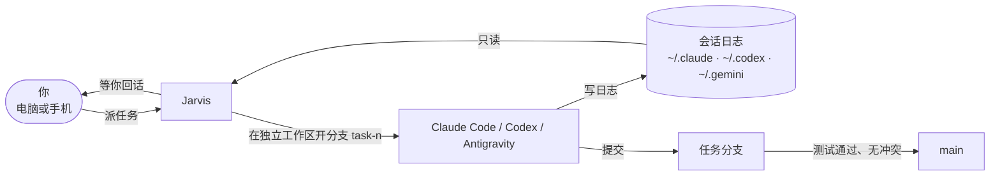

# Jarvis

[English](README.md)

**本机所有编程 agent 一屏看全；哪个在等你回话，电脑上、手机上都能直接回。**



Claude Code、Codex、Antigravity 的会话同时开着好几个时，难的已经不是写代码，而是及时发现哪个会话停下来在等你回答。
Jarvis 读取这些工具本来就会写的会话日志，按「现在该谁动」排好；新任务派出去，各自在独立的 git 分支上跑。

整个程序就是一个 Python 进程（FastAPI）加一个原生 HTML/JS 页面：没有数据库，不需要构建。

## 能做什么

- **所有会话一屏看全**：Claude Code、Codex、Antigravity 按项目归类，在跑、等你、刚做完、快到上下文上限一眼可见。只读，不改它们的日志。
- **在哪都能回**：打开会话就能看对话、回复、打断，或排队下一条指令，手机上也一样。
- **任务并行**：每个任务在自己的 git worktree 和分支里无人值守地跑，测试通过后在页面上一键合并。
- **按「该谁动」排的看板**：Todo / 排队 / 进行中 / 等你 / 已完成。
- **额度一目了然**：Claude、Codex、Antigravity 各还剩多少。


<p>
  
  
</p>

<sub>截图里是虚构的演示项目。</sub>

## 工作方式



你自己开的会话（终端、桌面版）也一样显示：Jarvis 只读它们的日志，你在页面上发的回复会接着这个会话继续。

## 环境要求

- Python 3.11+
- `git`
- `PATH` 里至少有一个已登录的 agent 命令行：
  - `claude`（Claude Code）：大部分功能依赖它
  - `codex`（OpenAI Codex CLI）：可选
  - `agy`（Google Antigravity）：可选
- 主要在 macOS 上开发和使用。Linux 大体可用但没有测过；Claude 桌面版的会话清单只在 macOS 上有。

## 快速开始

```bash
git clone https://github.com/alizeeblack-code/jarvis.git
cd jarvis
pip3 install -r requirements.txt
./start.sh            # http://localhost:5100
```

- 换端口：`./start.sh 8080`
- `static/` 下文件改动时自动重载：`./start.sh --dev`

启动后点「+ 新建项目」，选一个 git 仓库。添加项目时，Jarvis 会在该仓库的 `CLAUDE.md` 末尾追加一段任务说明，并新建 `PROGRESS.md`，这样 agent 就知道怎么回报进度。任务说明用添加时的界面语言写（先用页头的「中 / EN」切换）。

### 让 agent 能用任务工具（可选）

```bash
claude mcp add --transport stdio -s user task-manager -- python3 /path/to/jarvis/mcp_task_server.py
```

MCP 服务会自己找到正在运行的 Jarvis：Jarvis 启动时会把端口记在 `data/server_port`。要指定别的地址，设置 `JARVIS_URL`。

## 安全

**对本机以外开放之前，请先读这一节。**

### agent 的权限很大

任务是无人值守运行的，中途没法停下来等你批准：

- **Claude**：始终自动批准所有工具调用，不受项目设置影响。
- **Codex 和 Antigravity**：项目设置「完全跳过权限」关闭时在沙箱里运行，只能写工作区，可以联网；打开后不受限制。

只添加你信任的仓库。能访问 Jarvis，就等于拿到了你这个用户账号的 shell。

### 默认只能在本机访问

- Jarvis 默认只监听 `127.0.0.1`，本机发出的请求不需要令牌。
- 浏览器里的跨站请求一律拒绝，所以你打开的网页没法借你的浏览器操控 `localhost` 上的 Jarvis。
- 没有 TLS。需要加密时，走 VPN 或套一层 HTTPS 反向代理。

### 从手机或其他电脑访问

1. 用 `JARVIS_HOST=0.0.0.0 ./start.sh` 启动，最好只在 Tailscale 这类 VPN 里可达。
2. 其他设备都要访问令牌。令牌首次运行时生成在 `data/access_token`，也可以用 `JARVIS_TOKEN` 指定。
3. 在本机打开 Jarvis，点页头的手机图标，里面有带令牌的现成链接。在另一台设备上打开一次，之后靠 cookie 保持登录。
4. API 客户端可以发 `Authorization: Bearer <令牌>`。

如果在同一台机器上给 Jarvis 套了反向代理，要设置 `JARVIS_LOCAL_NO_TOKEN=0`，否则所有经代理进来的请求都会被当成本机请求。

## 配置

| 变量 | 默认值 | 作用 |
|---|---|---|
| `JARVIS_HOST` | `127.0.0.1` | `start.sh` 监听的地址 |
| `JARVIS_TOKEN` | `data/access_token` 的内容 | 其他设备用的访问令牌 |
| `JARVIS_LOCAL_NO_TOKEN` | `1` | 本机套反向代理时设为 `0` |
| `JARVIS_URL` | `http://localhost:<记录的端口>` | `mcp_task_server.py` 把进度发到哪里 |

每个项目的设置在项目设置弹窗里，包括：测试命令、新工作区准备命令、最大并行任务数、dev 端口、自动提交、跳过权限。

### Antigravity 模型

Antigravity 任务可选的模型内置在 `usage.py` 里。要改的话，新建 `data/models.json`；没写的项沿用内置值：

```json
{
  "antigravity": {
    "default": {"model": "gemini-4-hydrogen-high", "label": "Hydrogen"},
    "fallback": "claude-sonnet-5-5-high",
    "choices": {
      "argon": {"model": "gemini-4-argon-high", "label": "Argon"}
    },
    "keep_high": ["claude-opus-5-5"]
  }
}
```

- `default`：任务没选模型时用它。
- `fallback`：所选模型额度用完时接着试它。
- `choices`：任务输入框里的其他选项。
- `keep_high`：这些模型系列运行时不低于 `-high` 档。上面列出的模型所属系列已自动算在内。

改完重启 Jarvis 生效。Claude 和 Codex 用的是各自命令行里设置的模型。

## 目录结构

| 路径 | 内容 |
|---|---|
| `server.py` | FastAPI 应用：REST API、WebSocket、worker 调度 |
| `access.py` | 访问控制（令牌、跨站检查） |
| `worker.py`、`agents.py` | 运行 Claude / Codex / Antigravity 任务 |
| `gitflow.py` | 工作区、分支、合并 |
| `sessions.py`、`overview.py`、`board.py` | 会话索引、总览、看板 |
| `transcript.py`、`session_send.py` | 读会话、从网页续写会话 |
| `store.py` | 项目与任务（`data/projects.json`） |
| `usage.py` | 额度统计 |
| `mcp_task_server.py` | 给本机 agent 用的 MCP 任务工具 |
| `mcp_task_client.py` | 同一套工具，给另一台机器上的 agent 通过 HTTP 用（`--host`、`--port`、`--token`） |
| `static/` | 前端 |
| `data/`、`logs/` | 运行时数据（不进 git） |

## 测试

```bash
python3 -m pytest tests -q
```

## 致谢

- [Agent Deck](https://github.com/asheshgoplani/agent-deck)：本机所有 agent 会话的总览、卡片上的进度胶囊借鉴了它。
- Nautilus Spiral：首页的螺旋表盘。
- 《提高 Agentic Coding 吞吐量的 10 个阶段》：多个 agent 并行、各领一个任务的思路，这个项目由此起步。

## 许可证

[MIT](LICENSE)
