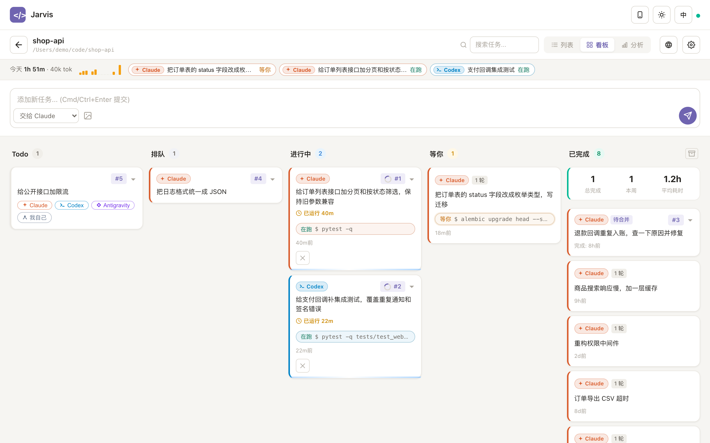
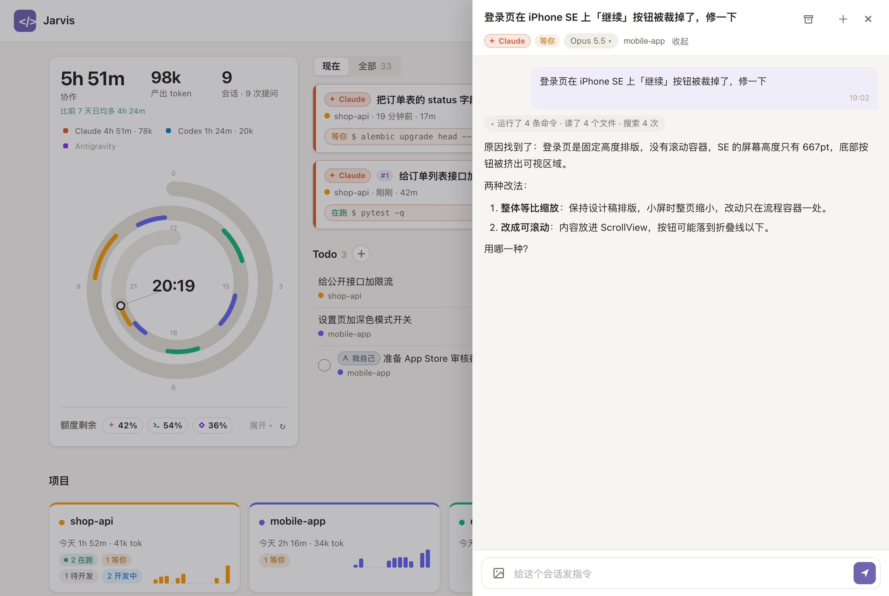
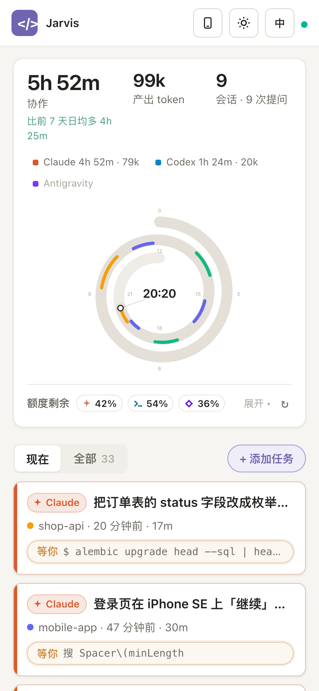
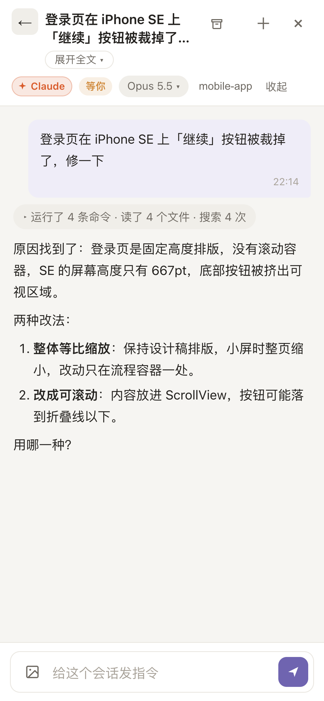
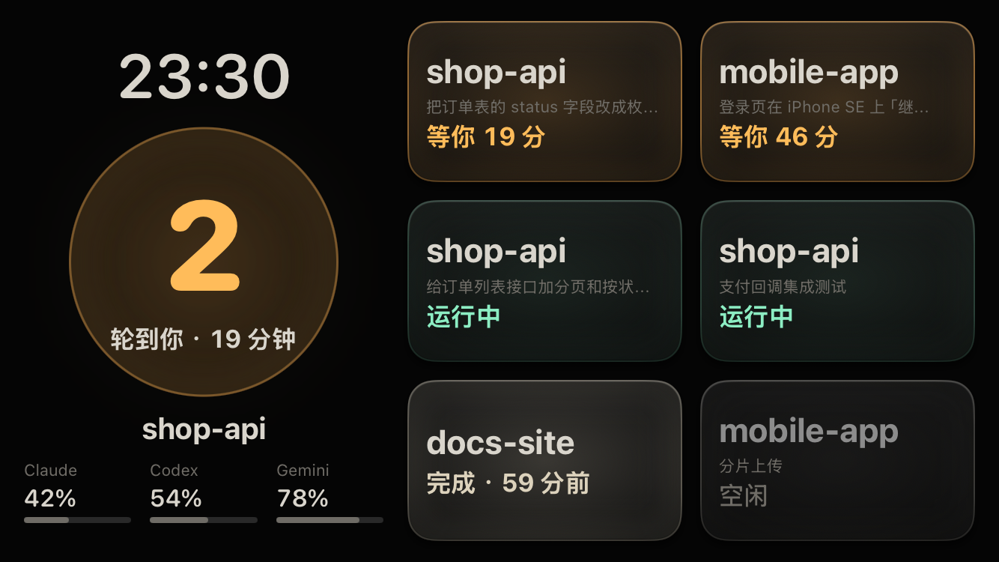

# Jarvis

[English](README.md)

**本机所有编程 agent 一屏看全；哪个在等你回话，电脑上、手机上都能直接回。**

一个自托管的 Claude Code、OpenAI Codex、Google Antigravity 会话看板：哪个会话在跑、哪个在等你、哪个做完了，一眼可见；在手机上就能回复；任务并行，各自跑在独立的 git worktree 里。


Claude Code、Codex、Antigravity 的会话同时开着好几个时，难的已经不是写代码，而是及时发现哪个会话停下来在等你回答。
Jarvis 读取这些工具本来就会写的会话日志，按「现在该谁动」排好；新任务派出去，各自在独立的 git 分支上跑。

整个程序就是一个 Python 进程（FastAPI）加一个原生 HTML/JS 页面：没有数据库，不需要构建。

## 能做什么

- **所有会话一屏看全**：Claude Code、Codex、Antigravity 按项目归类，在跑、等你、刚做完、快到上下文上限一眼可见。只读，不改它们的日志。
- **在哪都能回**：打开会话就能看对话、回复、打断，或排队下一条指令，手机上也一样。
- **任务并行**：每个任务在自己的 git worktree 和分支里无人值守地跑，测试通过后在页面上一键合并。
- **按「该谁动」排的看板**：Todo / 排队 / 进行中 / 等你 / 已完成。
- **额度一目了然**：Claude、Codex、Antigravity 各还剩多少。
- **桌上的一盏灯**：旧 iPhone 变成 agent 的状态灯，点一下就在 Mac 上打开那个会话（见[桌面状态屏](#桌面状态屏可选)）。



<p>
  
  
  
</p>

<sub>截图里是虚构的演示项目。</sub>

## 和同类工具的区别

同时跑多个编程 agent 的工具，大多是「启动器」：agent 在它里面跑。Jarvis 反过来，是「观察者」：你已经开着的会话，不管是在终端、Claude 桌面 app、Codex 还是 Antigravity 里开的，它都看得到，并告诉你哪个在等你，人在不在电脑前都行。

| | Jarvis | [Linear](https://linear.app/coding-sessions) | [Conductor](https://conductor.build) | [Herdr](https://github.com/ogulcancelik/herdr) | [Claude Squad](https://github.com/smtg-ai/claude-squad) | [Agent Deck](https://github.com/asheshgoplani/agent-deck) |
|---|---|---|---|---|---|---|
| 形态 | 本地网页看板 + 桌面状态灯 | 任务管理工具，agent 跑在 Linear 云端 | Mac app | 给 agent 用的终端多路复用器 | 终端程序（tmux） | 终端程序（tmux）+ 网页界面 |
| agent 跑在哪 | 你自己的电脑 | Linear 云端 | 你的 Mac | 你自己的电脑（或经 ssh 的远程机） | 你自己的电脑 | 你自己的电脑 |
| 在别处开的会话 | 读日志自动出现 | — | 只管自己开的 | 只管自己开的 | 只管自己开的 | — |
| 按「该谁动」排序 | 是 | — | 每个任务有状态 | 工作中 / 卡住 / 完成 | 每个任务有状态 | 每个会话有状态 |
| 手机 | 看、回复、打断 | Linear 手机 app | — | — | — | 网页界面 |
| 状态灯，点一下在 Mac 上打开 | 是 | — | — | — | — | — |
| 并行任务与分支 | 每个任务一个 worktree；测试通过、检查无冲突后合并 | 产出 PR 草稿 | 每个任务一个工作区；看 diff、开 PR、合并 | — | 每个任务一个 worktree；提交并推送 | 支持 worktree |
| 许可 | MIT | 付费服务 | 闭源 | Apache-2.0 | AGPL-3.0 | MIT |

同时开着好几个 agent、想随时知道哪个在等你，选 Jarvis；想把 agent 本身装进一个 app 或一个终端里管，选启动器。两者可以一起用。其他工具的情况来自各自 2026 年 11 月的官方页面。

## 工作方式


你自己开的会话（终端、桌面版）也一样显示：Jarvis 只读它们的日志，你在页面上发的回复会接着这个会话继续。

## 环境要求

- Python 3.11+
- `git`
- `PATH` 里至少有一个已登录的 agent 命令行：
  - `claude`（Claude Code）：大部分功能依赖它
  - `codex`（OpenAI Codex CLI）：可选
  - `agy`（Google Antigravity）：可选
- 主要在 macOS 上开发和使用。Linux 大体可用但没有测过；Claude 桌面版的会话清单只在 macOS 上有。

## 快速开始

```bash
git clone https://github.com/alizeeblack-code/jarvis.git
cd jarvis
pip3 install -r requirements.txt
./start.sh            # http://localhost:5100
```

- 换端口：`./start.sh 8080`
- `static/` 下文件改动时自动重载：`./start.sh --dev`

启动后点「+ 新建项目」，选一个 git 仓库。添加项目时，Jarvis 会在该仓库的 `CLAUDE.md` 末尾追加一段任务说明，并新建 `PROGRESS.md`，这样 agent 就知道怎么回报进度。任务说明用添加时的界面语言写（先用页头的「中 / EN」切换）。

### 让 agent 能用任务工具（可选）

```bash
claude mcp add --transport stdio -s user task-manager -- python3 /path/to/jarvis/mcp_task_server.py
```

MCP 服务会自己找到正在运行的 Jarvis：Jarvis 启动时会把端口记在 `data/server_port`。要指定别的地址，设置 `JARVIS_URL`。

## 桌面状态屏（可选）



`/desk` 是给桌上旧手机用的状态屏：左边一盏大灯说明总体情况，右边六颗磨砂方形键，一颗对应一个会话，用柔和的颜色表示状态（蓝色运行中、琥珀色等你、绿色完成、灰色空闲、红色出错；iOS App 里运行中是薄荷绿、完成是暖白），只有需要你的那颗会慢慢呼吸。会话轮到你、完成或出错时，整屏淡淡泛一下对应的颜色并响铃；轮到你的会话没处理，每 5 分钟再响一次，点一下屏幕就停。点某颗键（或点大灯，对应灯上显示的那个会话），就在 Mac 上打开那个会话：Claude 桌面版的会话直接打开，终端或编辑器里的会话把那个 app 切到最前面。会先唤醒屏幕；Mac 锁着的话，会等你用 Touch ID 或 Apple Watch 解锁后再打开；如果你主动开启了自动解锁，就替你解锁（见[安全](#安全)一节）。从其他设备打开的方法也在那一节。

用手机浏览器打开时，要先点一下才能出声，而且屏幕会自动锁定，除非关掉「自动锁定」。`ios/JarvisDesk` 是原生 iOS App（SwiftUI，iOS 15 起），直接读 `GET /api/desk` 画出同样的界面，保持屏幕常亮，静音键打开时也能响铃，大灯上方显示时间、下方显示 Claude、Codex、Gemini 的剩余额度，10 分钟没有新情况会把屏幕调暗（夜里更暗）：

```bash
cd ios/JarvisDesk
./configure.sh <你的 Apple 团队 ID>   # 写入 Config/Local.xcconfig：本机地址和令牌
open JarvisDesk.xcodeproj             # 在手机上运行
```

两指长按可以修改地址。要装到 iOS 15 的设备上，需要 Xcode 26.0.1–26.6；Xcode 27 只能调试 iOS 17 及以上。

## 安全

**对本机以外开放之前，请先读这一节。**

### agent 的权限很大

任务是无人值守运行的，中途没法停下来等你批准：

- **Claude**：始终自动批准所有工具调用，不受项目设置影响。
- **Codex 和 Antigravity**：项目设置「完全跳过权限」关闭时在沙箱里运行，只能写工作区，可以联网；打开后不受限制。

只添加你信任的仓库。能访问 Jarvis，就等于拿到了你这个用户账号的 shell。

### 默认只能在本机访问

- Jarvis 默认只监听 `127.0.0.1`，本机发出的请求不需要令牌。
- 浏览器里的跨站请求一律拒绝，所以你打开的网页没法借你的浏览器操控 `localhost` 上的 Jarvis。
- 没有 TLS。需要加密时，走 VPN 或套一层 HTTPS 反向代理。

### 从手机或其他电脑访问

1. 用 `JARVIS_HOST=0.0.0.0 ./start.sh` 启动，最好只在 Tailscale 这类 VPN 里可达。
2. 其他设备都要访问令牌。令牌首次运行时生成在 `data/access_token`，也可以用 `JARVIS_TOKEN` 指定。
3. 在本机打开 Jarvis，点页头的手机图标，里面有带令牌的现成链接。在另一台设备上打开一次，之后靠 cookie 保持登录。
4. API 客户端可以发 `Authorization: Bearer <令牌>`。

如果在同一台机器上给 Jarvis 套了反向代理，要设置 `JARVIS_LOCAL_NO_TOKEN=0`，否则所有经代理进来的请求都会被当成本机请求。

### 从状态屏解锁 Mac（默认关闭）

要开启，需要你自己把登录密码存进登录钥匙串，并给运行 Jarvis 的 Python 开「辅助功能」权限（系统设置 → 隐私与安全性 → 辅助功能）：

```bash
security add-generic-password -U -s jarvis-unlock -a "$USER" -w
```

之后在锁屏状态下点状态屏，Jarvis 会把密码输入锁屏界面。每分钟最多试一次，密码不对就停一小时，不会把账号锁住。可以先用 `scripts/unlock-probe.sh` 确认这台 Mac 上能输入。**开启后，拿到访问令牌的人就能解锁这台 Mac**；删掉这条钥匙串项即可关闭。

## 配置

| 变量 | 默认值 | 作用 |
|---|---|---|
| `JARVIS_HOST` | `127.0.0.1` | `start.sh` 监听的地址 |
| `JARVIS_TOKEN` | `data/access_token` 的内容 | 其他设备用的访问令牌 |
| `JARVIS_LOCAL_NO_TOKEN` | `1` | 本机套反向代理时设为 `0` |
| `JARVIS_URL` | `http://localhost:<记录的端口>` | `mcp_task_server.py` 把进度发到哪里 |

每个项目的设置在项目设置弹窗里，包括：测试命令、新工作区准备命令、最大并行任务数、dev 端口、自动提交、跳过权限。

### Antigravity 模型

Antigravity 任务可选的模型内置在 `usage.py` 里。要改的话，新建 `data/models.json`；没写的项沿用内置值：

```json
{
  "antigravity": {
    "default": {"model": "gemini-4-hydrogen-high", "label": "Hydrogen"},
    "fallback": "claude-sonnet-5-5-high",
    "choices": {
      "argon": {"model": "gemini-4-argon-high", "label": "Argon"}
    },
    "keep_high": ["claude-opus-5-5"]
  }
}
```

- `default`：任务没选模型时用它。
- `fallback`：所选模型额度用完时接着试它。
- `choices`：任务输入框里的其他选项。
- `keep_high`：这些模型系列运行时不低于 `-high` 档。上面列出的模型所属系列已自动算在内。

改完重启 Jarvis 生效。Claude 和 Codex 用的是各自命令行里设置的模型。

## 目录结构

| 路径 | 内容 |
|---|---|
| `server.py` | FastAPI 应用：REST API、WebSocket、worker 调度 |
| `access.py` | 访问控制（令牌、跨站检查） |
| `worker.py`、`agents.py` | 运行 Claude / Codex / Antigravity 任务 |
| `gitflow.py` | 工作区、分支、合并 |
| `sessions.py`、`overview.py`、`board.py` | 会话索引、总览、看板 |
| `transcript.py`、`session_send.py` | 读会话、从网页续写会话 |
| `store.py` | 项目与任务（`data/projects.json`） |
| `usage.py` | 额度统计 |
| `desk.py`、`static/desk.*` | 桌面状态屏（`/desk`） |
| `reveal.py` | 在状态屏上点键时，在 Mac 上打开那个会话（以及可选的自动解锁） |
| `scripts/unlock-probe.sh` | 检查这台 Mac 上能不能用自动解锁输入密码 |
| `ios/JarvisDesk/` | 桌面状态屏的原生 iOS App |
| `mcp_task_server.py` | 给本机 agent 用的 MCP 任务工具 |
| `mcp_task_client.py` | 同一套工具，给另一台机器上的 agent 通过 HTTP 用（`--host`、`--port`、`--token`） |
| `static/` | 前端 |
| `data/`、`logs/` | 运行时数据（不进 git） |

## 测试

```bash
python3 -m pytest tests -q
```

## 致谢

- [Agent Deck](https://github.com/asheshgoplani/agent-deck)：本机所有 agent 会话的总览、卡片上的进度胶囊借鉴了它。
- Nautilus Spiral：首页的螺旋表盘。
- 《提高 Agentic Coding 吞吐量的 10 个阶段》：多个 agent 并行、各领一个任务的思路，这个项目由此起步。

## 许可证

[MIT](LICENSE)
